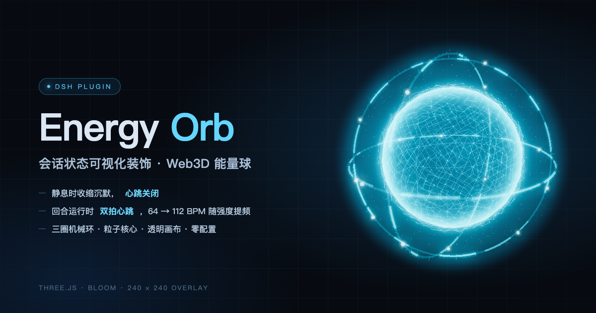
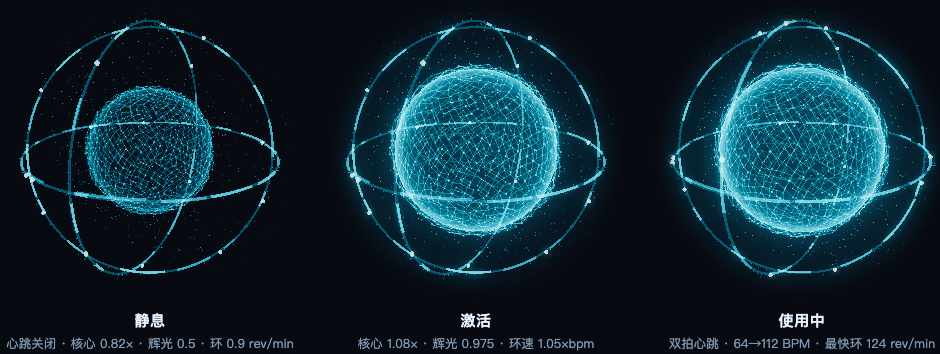
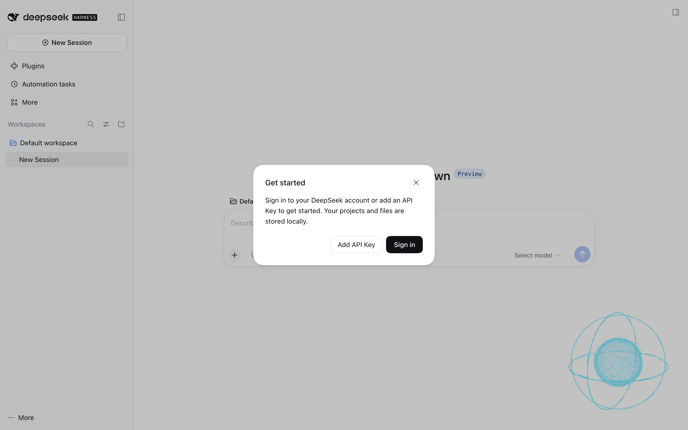
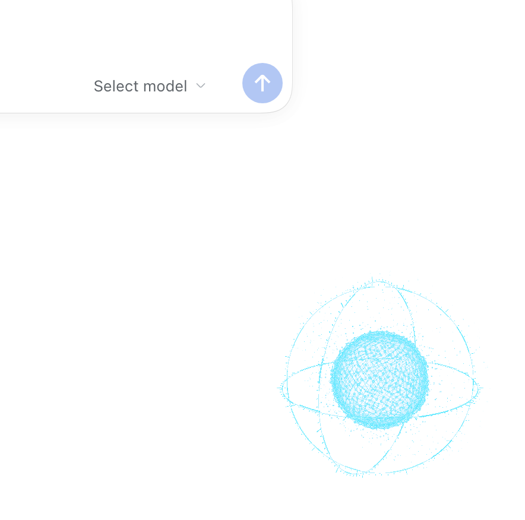
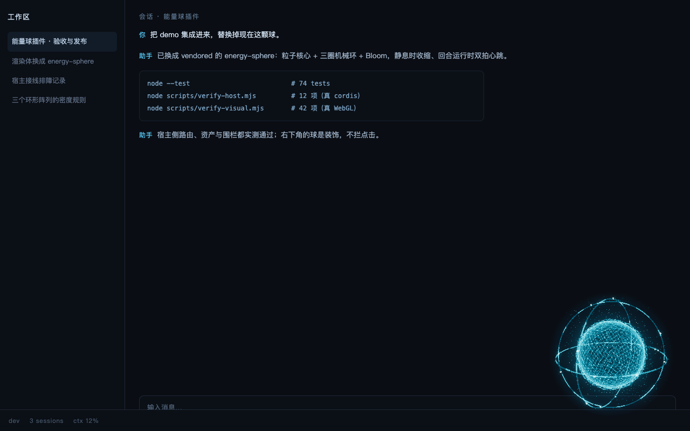

# dsh-energy-orb

**DSH Web GUI 的 Web3D 能量球插件** —— 会话状态可视化装饰：静息时收缩沉默，回合运行时以双拍心跳涨缩。

<p align="center">
  
</p>

<p align="center">
  <a href="https://www.npmjs.com/package/@dsh-fly/dsh-energy-orb"></a>
  <a href="https://github.com/ethanchen669/dsh-energy-orb/blob/main/LICENSE"></a>
  
</p>

## 它是什么

一颗浮在界面右下角的能量球，**只做状态可视化**：不吃交互、不拦点击、不改变任何业务行为。

- **跟随当前会话**：状态看的是**左侧栏当前打开的那个会话**（`retainedBy.mainView`），切换会话立刻跟着变；宿主没有 `sessions` 服务时退回「任一回合在跑即激活」的全局口径。
- **静息**（没有回合在跑）：核心缩到 0.82×、辉光压到 0.5、**心跳关闭**——静态就是静态。
- **激活**（回合开始运行，与扫描杠亮起是同一个事件）：核心 1.08×、辉光 0.975（约为最初的 75%），进入**双拍心跳**，
  心率 64 → 112 BPM 随活动强度提频；**环速跟心跳挂钩**：最快那圈 71 → 124 rev/min
  （0.85s → 0.49s 一圈，仍是 bpm 的 1.1 倍），核心按 0.6× 环速转（42 → 74 rev/min），
  另两环与灰尘场按基准角速度等比例推进，静息守在 0.825×（旧静息的 1.5 倍）。
  转速有自己更陡的 ramp（**170ms 精确落位**，比其余参数的 420ms 更快）——静息↔运行切换时先给你一记"起转"，
  核大小/亮度仍按 420ms 过渡；所有自转都是逐帧增量积分的，越用越久也不会出现"回卷抽搐"。
- **点击**充能一次（单次能量脉冲）、**拖拽**换位置（位置/尺寸/显隐记在 localStorage）。
- 尊重 `prefers-reduced-motion`：停环、关心跳，只保留大小与亮度差异。

<p align="center">
  
</p>

材质是粒子能量核心 + 三圈前向机械环（刻度 / 节点 / 弧光，**环管径 0.025** —— 0.007 的细线在 Bloom 里读不出转速，0.18 又太粗会遮住核心，0.025 是当前定稿；环上亮点直径 = 环厚的 4 倍（细环上 1.5×/2.2× 都只多零点几像素，读不出来））+ UnrealBloom，基于 `three@0.180.0`。

## 装在界面的哪里

右侧留白、不挡内容 —— 默认 192 × 192 的悬浮层，贴在右下角（`shell.overlay`），可拖拽到任意角落。
**官方 UI 实拍**（纯净 DSH Web GUI，未加载任何皮肤）：

<p align="center">
  
</p>

<p align="center">
  
</p>

<p align="center">
  
</p>

## 安装

```bash
# 发布到 npm 之后（版本按实际最新）
cd ~/.dsh
dsh plugin --profile=<你的 profile> add @dsh-fly/dsh-energy-orb --registry=https://registry.npmjs.org/
```

装完**必须重启 `dsh web`**：引擎把客户端包缓存在进程内，只刷新页面不够。

开发期直接装本地目录（软链，改码即生效，重启后加载）：

```bash
cd ~/.dsh
dsh plugin --profile=<你的 profile> add link:/绝对路径/dsh-plugins/dsh-energy-orb
```

## 配置

| 项 | 位置 | 说明 |
| --- | --- | --- |
| `enabled` | cordis Config | 唯一配置项，默认 `true`；关掉等于不挂载 |
| `visible` / `size` / `anchor` / `offset` | 浏览器 localStorage，键 `energy-orb.display` | 显隐、直径（`size` 32–256，默认 96 → 192px）、贴哪一角、拖拽偏移 |

没有别的配置面：状态来自 Harness 的会话事件，不来自配置。

## 工作原理

```
Harness 'api-session/status' ─→ ActivityProjector（Host 折叠 running 集合）
                                     │  { version:1, active, intensity, phase, updatedAt }
                                     ▼
                     GET /api/energy-orb/state   （loopback-only 围栏）
                                     │  2s 轮询 / 10s 退避
                                     ▼
   OrbClient（shell.overlay）── 状态 → 球体参数（420ms 插值）──→ SphereRenderer
                                     │                         （vendored three 闭包）
                                     └── import('/energy-orb/assets/sphere/energy-sphere.js')
```

- **Host 零持久化**：`running` 集合在内存里；`updatedAt` 是每次快照的时刻（liveness 心跳），
  所以**长回合不会被误判成陈旧**。
- **插件名 / 行 id**：`dsh-fly-energy-orb`（bundle patch 的行 id，市场与配置里看到的就是它）；
  npm 包名是 `@dsh-fly/dsh-energy-orb`，客户端 bundle 的 `ModuleLoader` id 用完整包名。
- **资产路由只放行精确白名单**（15 个文件：球体模块 + `three` 闭包），越界 404、非 loopback 403。
- **运行期零依赖**：`three` 与后处理链是 vendored 副本（MIT，含 license 头），装包不需要构建、
  不需要 `npm install`、不会因为上游 three 升版而碎。vendored 资产由
  [`scripts/vendor-sphere.mjs`](https://github.com/ethanchen669/dsh-energy-orb/blob/main/scripts/vendor-sphere.mjs)
  按 import 图遍历生成，`client/vendor/manifest.json` 记 sha256 与溯源。
- **失败即降级**：模块 404 / WebGL 不可用 / 上下文丢失 → 可见的 CSS 降级球（渐变 + 呼吸），
  `console.warn` 恰一次，不空白、不炸页。

## 兼容性

- 平台：**DSH Web GUI**（`dsh.client.platform = "web"`，挂 `shell.overlay`，root 级悬浮层）。
- 依赖宿主提供的 `webServer` 服务（路由）与 `api-session/status` 事件；缺任一则该插件不生效，而不是拖垮宿主。
- 需要 WebGL2；不可用时自动降到 CSS 球。

## 开发与验证

```bash
node --test                                # 单测：宿主接线 / 状态契约 / 映射表 / 降级 / vendor 完整性
node scripts/verify-host.mjs               # 宿主级集成：真 cordis + 真 dsh-host-webserver 起真监听（12 项）
node scripts/verify-visual.mjs             # 浏览器 probe：真资产路由 + 真 WebGL 像素（42 项；产物落 .tmp/，加 --save 写回 docs/verify/）
node scripts/verify-live.mjs --self-test   # live 检查脚本自证
node scripts/vendor-sphere.mjs --check     # vendored 资产与上游 demo 是否一致
node scripts/shoot-readme.mjs              # 重出 README 效果图（docs/images/*.png）
```

本仓同时被 `dsh-fly` 的 [`plugins.lock.json`](https://github.com/ethanchen669/dsh-fly/blob/main/plugins.lock.json) 登记为外部插件：
`scripts/` 下四个契约脚本（构建器 / 源哈希 / 两道署名闸门）必须是主仓同名脚本的**逐字节副本**
（`npm test` 里有一条比对，主仓在本机时生效；主仓门禁会以同样的尺子量这里）。

发版流程（首次 `npm stage publish` → 配 Trusted Publisher → 之后推 tag 自动发）见
[`docs/publishing.md`](https://github.com/ethanchen669/dsh-energy-orb/blob/main/docs/publishing.md)。

设计、决策记录与验收：[`docs/design.md`](https://github.com/ethanchen669/dsh-energy-orb/blob/main/docs/design.md) ·
[`docs/adr/`](https://github.com/ethanchen669/dsh-energy-orb/tree/main/docs/adr) ·
[`docs/plans/`](https://github.com/ethanchen669/dsh-energy-orb/tree/main/docs/plans)（含逐条实测的验收契约）。

## License

[MIT](https://github.com/ethanchen669/dsh-energy-orb/blob/main/LICENSE)。vendored 的 `three@0.180.0`
同为 MIT（Copyright © 2010-2025 three.js authors，license 头随文件一起分发）；
球体组件的来源、补丁与 vendored 清单见
[`client/vendor/README.md`](https://github.com/ethanchen669/dsh-energy-orb/blob/main/client/vendor/README.md)。
